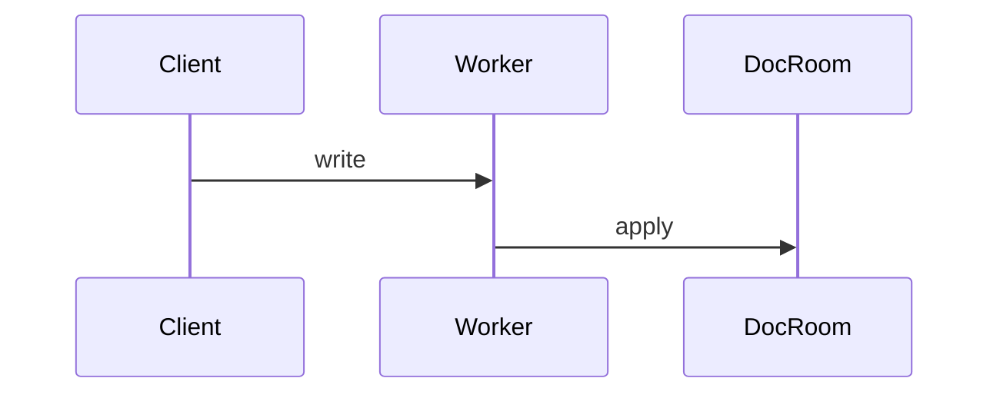

# Components inside a page

A page body is markdown, and these blocks render as components inside it. Write each block alone, with a blank line before and after. Use one where it helps a reader; a paragraph is still the default.

## Where each one works

Readers open a page in the Nimbalyst desktop app, the team web console, or, for a local wiki of files, its browser view. "Shown" means it renders but does nothing when clicked outside the desktop app.

| Component | Desktop | Team web | Local browser |
| --- | --- | --- | --- |
| Callout, columns, tabs | yes | yes | yes |
| Mermaid, `chart`, `2x2`, `toc`, `excerpt` | yes | yes | yes |
| `decision` block | yes | yes | yes |
| Mentions, decision and open marks, sized images | yes | yes | yes |
| `action`, `new-item` buttons | yes | shown, disabled | shown, disabled |
| Embedded editor page | yes | "preview unavailable" | yes |
| Embedded HTML page | yes | yes | yes |
| Placed view, marks list | yes | yes | no, a note |
| Link preview card | yes, with page details | yes, URL and site | yes, URL and site |
| Transclusion | yes | a note, open the page | a note, open the page |

**Never write these in a wiki page:** math (`$x$`, `$$`), `<details>` collapsibles, and ` ```board-table `. Pages written through the wiki tools keep them as literal text (a collapsible or board-table can also stop the local browser view from showing the page). Use tabs for content a reader should be able to fold away, and a placed view for a board of items.

## Callout

`> [!TYPE] Optional title`, then the body as `> ` lines. TYPE is one of `NOTE`, `TIP`, `IMPORTANT`, `WARNING`, `CAUTION`.

```markdown
> [!WARNING] Personal JWT is for personal sync only
> Team collaboration always uses the team JWT.
```

Use one for the one thing a reader must not miss. Never use a callout to hold a decision; a decision is a marked sentence.

## Columns

Each tag alone on its line, blank lines around the markdown inside each column. `data-columns` takes CSS grid widths.

```markdown
<div data-columns="2fr 1fr">
<div data-column>

The editor owns its content state.

</div>
<div data-column>

- Lexical
- Monaco

</div>
</div>
```

People read pages on phones, so use columns for two short, related things (before and after, a picture and its legend), never for layout.

## Tabs

```markdown
<div data-tabs>
<details data-tab>
<summary>macOS</summary>

Install with the DMG.

</details>
<details data-tab>
<summary>Windows</summary>

Install with the MSI.

</details>
</div>
```

Use tabs for alternatives a reader picks one of (platform, plan, language).

## Mermaid

A fenced `mermaid` block renders as a diagram. Use it for a flow or sequence that reads top to bottom.

````markdown

````

## Chart

A fenced `chart` block holds YAML. `type` is `bar`, `line`, `area`, `pie` or `scatter`. `x` names the category column, `y` one number column or a list of them (pie takes one). `data` is CSV text with a header row, or a YAML list of rows. Optional `title`, `width` (px, at least 240), `height` (px, 120 to 1200).

````markdown
```chart
type: line
title: Sessions per week
x: week
y: [desktop, web]
data: |
  week,desktop,web
  2026-09-01,120,14
  2026-09-08,131,22
```
````

Use it for a handful of numbers a reader should see as a trend or a comparison, with the source of the numbers cited next to it. To chart a type's pages, place a view with `mode=chart` instead (see Placed views).

## 2x2

A fenced `2x2` block, one entry per line (not YAML). `x:` and `y:` are axis captions, low to high. `quadrants:` names top-left, top-right, bottom-left, bottom-right, split by `|`. Each point is `- Label: x, y` with values from 0 to 1; a trailing ` !` highlights it. Optional `width`, `height`.

````markdown
```2x2
x: Marketer-first, closed -> Developer-first, open
y: Batch -> Realtime decisioning
quadrants: Enterprise suites | Opportunity | Guidance and engagement | Dev-first
- Salesforce: 0.15, 0.85
- UserCurrent: 0.85, 0.9 !
```
````

Use it for a positioning question with a handful of named things. When the points are pages of one type with two number fields, place a view with `mode=2x2` instead, so it stays current.

## Table of contents

````markdown
```toc
depth: 2
```
````

`depth` is 1 to 6 (default 3). Only for a long page with several sections; most pages are too short to need one.

## Code excerpt

A fenced `excerpt` block quotes lines from a source file: a YAML header (`path` required, `lines` like `10-12`, optional `commit`), a `---` line, then the quoted lines exactly as they are in the file.

````markdown
```excerpt
path: packages/runtime/src/auth/jwtScopes.ts
lines: 10-12
commit: 749eca9a4
---
export type PersonalJwt = string & { __scope: 'personal' };

export type TeamJwt = string & { __scope: 'team' };
```
````

Quote a few lines when the exact code is the point. Copy the lines from the file; never retype them.

## Decision block

A fenced `decision` block puts a question to named people, who answer it in the page. Keys: `ask`, optional `description`, `type`, `asked` (names, a list or `greg, karl`), and `options` (a list of strings, or mappings with `id`, `label`, `description`). `type` is one of:

- `singleSelect` (default): pick one; `allowOther: true` adds a write-in.
- `multiSelect`: pick several; `minSelected`, `maxSelected`.
- `reorder`: rank the `options`; `minItems`.
- `editText`: edit a draft; `seed` holds the draft, `format` is `markdown` or `plain`.
- `confirm`: yes or no.
- `rating`: a score; `min` (default 1), `max` (default 5), `minLabel`, `maxLabel`.

````markdown
```decision
ask: Which navigation model for the web console?
type: singleSelect
asked: greg, karl
options:
  - id: gutter
    label: Icon gutter that expands to words
  - id: topbar
    label: Top bar with a project switcher
```
````

The app records the answer, who answered, when, and each vote in the block; never write `resolved`, `resolvedAt`, `resolvedBy` or `votes` yourself. Use a decision block only when the team has to choose and you can name who; an `id` is added when the page saves. A choice already made is a marked sentence, never a block. Once a block is resolved, also write the outcome as a `decided` mark in the page it affects. Leave out `artifact:`: it names a file on one machine.

## Buttons

An `action` block is a button that starts an agent session with its `prompt` (optional `label`, `model`, `effort`). A `new-item` block is a button that creates a page of `type` (optional `label`, `title`, `template` as markdown or a link to a page whose body to copy).

````markdown
```new-item
label: New decision record
type: decision
```
````

They only work when clicked in the desktop app, so add one only when the page is a place people start work from (a team's Home, a type's page), and say what it does in the sentence before it.

## Mentions and dates

A person is `[@Dana Lee](mailto:dana@example.com)`; a date is a bare `@2026-10-01`. Take the email from a citation snapshot or the team member list; never guess one.

## Images

`{800x600}` sets the image's size; write both numbers or neither.

## Embedded pages

A link alone in its paragraph to an editor page (a drawing, spreadsheet, mockup, HTML page and the rest) shows that page live inside this one. The title can set its size: `"width=800 height=500"`. See `editor-pages.md` for each type and the exact link to write.

## Placed views

Placed views are a team-wiki feature; skip them on a local wiki.

A view is a table of one type, placed on purpose. It is a link on its own line to the type's `viewLink`, with the settings in the title. Free-form values (labels, pin names) are percent-encoded.

| Key | Values |
| --- | --- |
| `mode` | `table` (default), `board`, `list`, `timeline`, `2x2`, `chart` |
| `cols` | visible fields, in order: `title,status,owner` |
| `sort` | `field` or `field:asc` (default descending), comma separated |
| `filter` | `field:value` clauses joined by `,`; `a\|b` is either; prefixes `!`, `>`, `<`, `>=`, `<=`; `empty`, `!empty`; dates take `today`, `+7d`, `-3d` |
| `group` | `status`, `priority`, `assignee`, `type`, `tag`, or a single-value field |
| `scope` | `open` or `all` (default) |
| `start`, `end` | date fields, for `timeline` |

- `mode=2x2` needs `x=` and `y=` (number fields). Optional `xl=` and `yl=` axis labels, `q=TL|TR|BL|BR` quadrant names, `pin=Label@0.85,0.9;Other@0.2,0.3` for fixed points.
- `mode=chart` needs `by=` (a single select, person, yes/no or date field). Optional `sum=` (a number field; without it, items are counted) and `chart=bar|line|area|pie`.

```markdown
[Competitors](https://console.nimbalyst.com/org/<orgId>/project/<projectId>/view/type/competitor "cols=title,devFirst,realtime sort=realtime:desc")

[Landscape](https://console.nimbalyst.com/org/<orgId>/project/<projectId>/view/type/competitor "mode=2x2 x=devFirst y=realtime xl=Developer-first yl=Realtime pin=UserCurrent@0.85,0.9")

[Revenue by tier](https://console.nimbalyst.com/org/<orgId>/project/<projectId>/view/type/customer "mode=chart by=tier sum=arr chart=pie")
```

A list of marks across pages uses the `openMarksViewLink` from `listPages` (`.../view/marks?kind=open`, or `kind=decided`).

## Link preview

A web link alone in its paragraph with `"preview=card"` shows a card; `"preview=embed"` plays the site's own player for sites that allow it (a video, a design file) and falls back to a card otherwise.

```markdown
[Flagship launch post](https://blog.cloudflare.com/ "preview=card")
```

## Transclusion

A team page link alone in its paragraph with the title `"transclude"` shows that page's body inside this one; add `#heading-slug` to the link to show one section. Only the desktop app shows the content; elsewhere the reader sees a note to open the page. Prefer an ordinary link; transclude only a short section that must read the same in two places.
